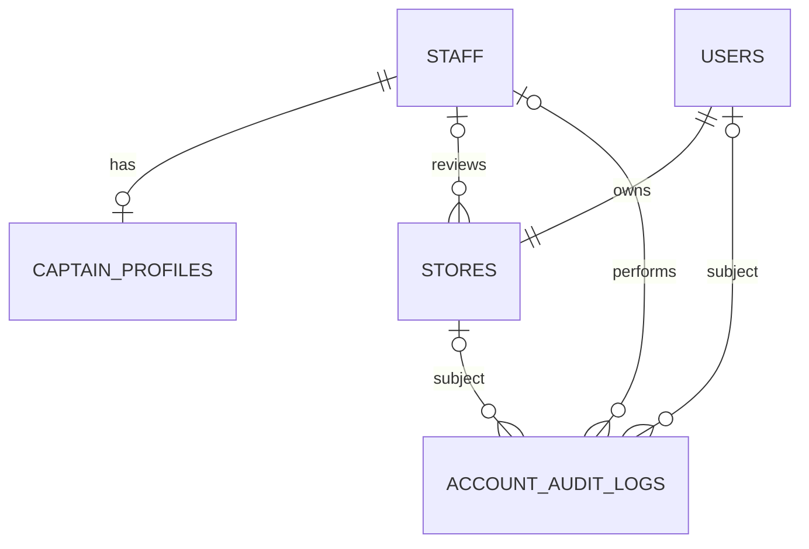

# مخطط المرحلة الأولى وقاموس البيانات

المرجع التنفيذي للحقول والقيود هو migration المرفق. مخطط الصلاحيات تنشئه migration مكتبة Spatie المنشورة بواسطة Artisan، ولا نكرر إنشاءه يدويًا.

## العلاقات الرئيسية

العلاقة بين المالك والمتجر: التسجيل ينشئهما معًا، وقيد `UNIQUE(owner_user_id)` يمنع أكثر من متجر للحساب. قاعدة البيانات وحدها لا تفرض أن لكل حساب متجرًا؛ المعاملة في خدمة التسجيل تضمن ذلك في مسار التطبيق.

## staff — حسابات الإدارة والكباتن

| العمود | النوع | مطلوب/افتراضي | القيود والغرض |
|---|---|---|---|
| id | BIGINT | تلقائي | مفتاح داخلي |
| public_id | ULID / CHAR(26) | يولده Model | فريد للروابط، ليس بديلًا عن التحقق من الصلاحية |
| name | VARCHAR(120) | نعم | اسم الموظف |
| phone | VARCHAR(20) | نعم | فريد بعد التطبيع إلى صيغة دولية |
| email | VARCHAR(254) | اختياري | للتواصل فقط؛ ليس معرف استعادة دخول في هذه المرحلة |
| password | VARCHAR(255) | نعم | hash عبر Laravel، محجوب عن التسلسل |
| status | active / suspended | active | لا حساب موظف يُنشأ من تسجيل عام |
| must_change_password | BOOLEAN | true | يُفرض عمليًا عند بناء مرحلة الدخول |
| session_version | UNSIGNED INT | 1 | إبطال الجلسات القائمة برفع الرقم |
| last_login_at | TIMESTAMP | اختياري | لم تُنفّذ كتابة وقت الدخول بعد |
| remember_token | VARCHAR(100) | اختياري | محجوب؛ تسجيل الدخول الدائم غير مفعّل |
| created_at, updated_at | TIMESTAMP | بواسطة Eloquent | أوقات الإنشاء والتعديل |

الفهارس: المفتاح الأساسي، public_id فريد، phone فريد، و(status,id). الأدوار مخزنة في جداول Spatie وليس في عمود role مكرر؛ هذا يسمح بإعطاء نفس الموظف دور إدارة ودور كابتن عند الحاجة.

## users — أصحاب المتاجر

نفس حقول الهوية السابقة، مع الاختلافات التالية:

| العمود | الاختلاف |
|---|---|
| status | pending / active / suspended، والافتراضي pending |
| must_change_password | الافتراضي false لأن التاجر يختار كلمة مروره |
| phone | فريد داخل users، لا عبر users وstaff معًا |

لا يحتوي جدول التجار على role أو نسبة خصم أو رصيد مالي. بيانات الاتفاقات والتسويات تحفظ في جداولها عند تنفيذها، حتى لا تصبح بيانات الحساب مرجعًا ماليًا قابلًا للتغيير بأثر رجعي.

## stores — المتاجر

| العمود | النوع | القيود والغرض |
|---|---|---|
| id | BIGINT | مفتاح داخلي |
| public_id | ULID | فريد |
| owner_user_id | BIGINT | FK إلى users، فريد، حذف المالك مرفوض مع وجود متجر |
| name | VARCHAR(160) | مطلوب |
| status | pending / active / suspended / rejected | pending افتراضيًا |
| reviewed_by_staff_id | BIGINT nullable | FK إلى staff، الحذف مرفوض للحفاظ على المرجع |
| reviewed_at | TIMESTAMP nullable | وقت آخر قرار |
| review_reason | VARCHAR(500) nullable | سبب آخر قرار؛ تاريخه الكامل في سجل التدقيق |
| created_at, updated_at | TIMESTAMP | أوقات السجل |

الفهرس التشغيلي: (status,created_at,id) لقائمة انتظار المراجعة. عناوين الاستلام والمناطق والتسعير تُربط بالمتجر في المراحل التالية.

## captain_profiles — خصائص الكابتن

| العمود | النوع | القيود والغرض |
|---|---|---|
| id | BIGINT | مفتاح داخلي |
| staff_id | BIGINT | FK فريد إلى staff، دون كلمة مرور أخرى |
| vehicle_type | bicycle / motorcycle / car | مطلوب؛ لا يُفترض نوع وسيلة التوصيل تلقائيًا |
| created_at, updated_at | TIMESTAMP | أوقات السجل |

خدمة إنشاء الموظف تنشئ الملف إذا مُنح دور captain. الربط بين وجود الملف والدور قاعدة تطبيق، وليس FK عابرًا إلى جداول الأدوار متعددة الأشكال.

## جداول الصلاحيات — Spatie

| الجدول | المسؤولية |
|---|---|
| roles | اسم الدور والحارس guard_name |
| permissions | اسم الصلاحية والحارس |
| role_has_permissions | ربط الأدوار بالصلاحيات |
| model_has_roles | إسناد الأدوار لحسابات staff |
| model_has_permissions | صلاحيات فردية تدعمها المكتبة؛ لا تستخدمها واجهة المرحلة الأولى |

قيد name + guard_name يمنع تكرار اسم الدور أو الصلاحية في نفس الحارس. جداول الربط لها مفاتيح مركبة حسب migration المكتبة. الربط polymorphic إلى staff يتحقق منه التطبيق ولا يفرض FK مباشرًا على جدول الهوية.

## account_audit_logs — سجل تغييرات الهوية

| العمود | النوع | الغرض |
|---|---|---|
| id | BIGINT | تسلسل السجل |
| actor_staff_id | FK nullable | الموظف المنفذ؛ null للتسجيل العام أو الإعداد الأول |
| subject_staff_id | FK nullable | حساب الموظف محل الحدث |
| subject_user_id | FK nullable | حساب التاجر محل الحدث |
| subject_store_id | FK nullable | المتجر محل الحدث |
| event | VARCHAR(80) | رمز الحدث |
| metadata | JSON | سبب/حالة سابقة/حالة لاحقة/أدوار فقط |
| created_at | TIMESTAMP | وقت الحدث؛ لا updated_at |

AuditRecorder يحدد موضوعًا واحدًا فقط في كل استدعاء. قيود FK تحمي المراجع، لكن شرط موضوع واحد قاعدة تطبيق وليس CHECK في هذا الإصدار. لا كلمات مرور أو رموز جلسات أو payload طلب كامل في السجل. فهرس لكل موضوع مع id لتصفح تاريخه دون تحميل بقية السجل.

## قواعد التطبيق وقيود قاعدة البيانات

| القاعدة | مكان تطبيقها |
|---|---|
| رقم جوال موحّد قبل فحص التكرار | PhoneNumber والخدمات ومحوّل Model |
| فريد داخل كل جدول هوية | UNIQUE في قاعدة البيانات |
| ملكية متجر واحد لحساب تاجر | UNIQUE + FK |
| إنشاء المالك والمتجر والسجل معًا | DB transaction |
| عدم قبول حقول دور أو تفعيل من التسجيل العام | قائمة حقول صريحة بالخدمة |
| التاجر لا يقرأ متجر غيره | StorePolicy + StoreDirectory |
| حماية آخر مشرف عام | قفل دور المشرف داخل المعاملة + تحقق من العدد |
| انتقال حالات مراجعة صالح | StoreReview |
| انتهاء الجلسات بعد الإيقاف | session_version + middleware على كل مسار محمي |

لا soft deletes ولا حذف جماعي لحسابات الفريق أو التجار ضمن خدمات هذه المرحلة. الإيقاف هو مسار التشغيل المعتاد. عند إضافة حذف أو إخفاء بيانات لسياسة احتفاظ يجب تصميمه دون إتلاف السجلات المالية والتدقيق.
